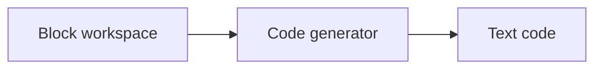
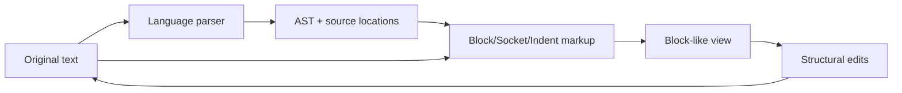
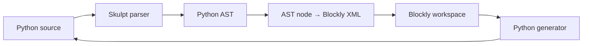
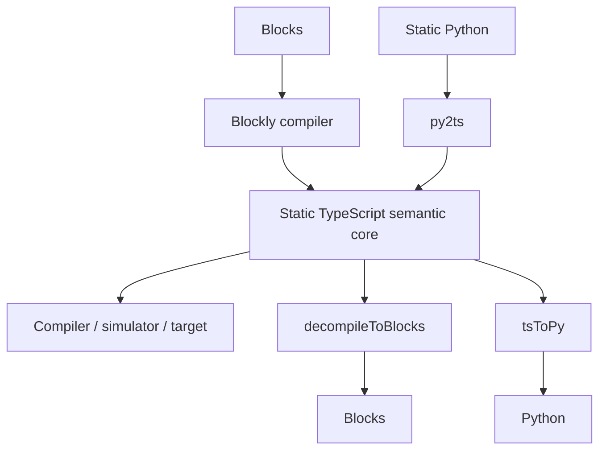
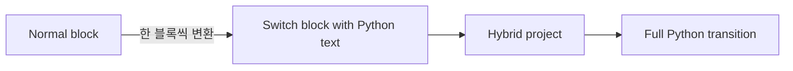

# 양방향 변환 아키텍처 패턴

> 조사 기준일: 2026-11-08

동일해 보이는 "블록 ↔ 텍스트" 기능도 내부 구조는 전혀 다릅니다.

## 패턴 A — Generator only



대표: Blockly 기본 사용, Tinkercad Blocks+Text의 기본 방향, 여러 mBlock 장치 모드.

### 장점
- 구현 난도가 가장 낮음
- block AST는 항상 문법적으로 유효하므로 code generation이 안정적
- 여러 텍스트 언어 generator를 붙이기 쉬움

### 한계
- Text → Block 경로가 없음
- 텍스트를 자유 편집하게 여는 순간 block state와 분기됨
- 사용자가 Text로 넘어가면 되돌릴 수 없다는 UX가 자주 발생

---

## 패턴 B — Text-preserving structural overlay

대표: **Droplet**, 이를 사용하는 **Pencil Code**, **Code.org App Lab/Game Lab**



Droplet의 핵심은 텍스트를 버리고 새 코드를 생성하지 않는다는 점입니다.

내부 문서상 model은 linked-list token으로 구성되고,
- blockStart / blockEnd
- socketStart / socketEnd
- indentStart / indentEnd
- text
- newline

같은 토큰을 사용합니다.

텍스트를 다시 얻을 때는 **구조 마크업을 제거하고 원래 text token을 이어 붙입니다.**

### 장점
- 사용자가 입력한 텍스트를 높은 수준으로 보존
- formatting이나 literal 표현을 generator가 임의로 다시 쓰는 문제가 적음
- "블록도 사실 코드"라는 전환 경험을 만들기 좋음

### 단점
- source range와 구조 편집을 안정적으로 유지하는 editor 구현이 복잡
- 언어마다 parser adapter가 필요
- 순수 Blockly 생태계와는 구조가 다름

### 중요한 통찰
양방향을 "두 개의 표현 사이 변환"으로만 보지 않고, **하나의 텍스트 모델을 두 방식으로 편집**하게 만들 수 있습니다.

---

## 패턴 C — AST reconciliation

대표: **BlockMirror / BlockPy**



### 소스에서 확인되는 구조
- `BlockMirror.code_`: 공유 코드 문자열
- Text editor: CodeMirror
- Block editor: Blockly
- `text_to_blocks.js`: Sk.parse → Sk.astFromParse → AST별 변환
- block editor `getCode()`: Python generator의 `workspaceToCode`
- setCode: Python을 parse하여 Blockly XML 재로드

### 파싱 실패 처리
BlockMirror는 아주 중요한 fallback을 둡니다.

Python 일부가 parse되지 않으면:
1. 가능한 앞부분까지 parse
2. 실패한 chunk를 분리
3. 해당 원문을 raw code block으로 남김

즉 "블록화할 수 없음 = 코드 삭제"가 아닙니다.

### 장점
- Python 학습용으로 개념적으로 명료
- AST node별 block mapping을 독립 파일로 확장 가능
- split view가 자연스러움

### 단점
- Python 문법이 확장될 때 mapping 유지보수 필요
- formatter 차이로 text fidelity가 낮아질 수 있음
- 모든 text construct가 교육용 block으로 자연스럽게 대응되지는 않음

---

## 패턴 D — Compiler / Decompiler semantic core

대표: **Microsoft MakeCode / PXT**



MakeCode 공식 언어 문서도 Blocks와 Static Python이 Static TypeScript로 변환된 뒤 하위 언어로 컴파일된다고 설명합니다.

PXT 소스에는:
- `main.blocks`
- `main.ts`
- `main.py`
- `pyToTs`
- `tsToPy`
- `decompileToBlocks`

가 명시적으로 존재합니다.

### 왜 강력한가
블록과 Python을 서로 직접 N×N 변환하지 않고 **공통 의미 계층**을 둡니다.

언어가 늘어날수록:
- 직접 변환: A↔B, A↔C, B↔C...
- 공통 IR: A↔IR, B↔IR, C↔IR

구조가 더 관리 가능합니다.

### 그러나 "완벽한 왕복"은 아님
PXT 코드에는 Blocks→TS roundtrip에서 block ID가 모두 바뀔 수 있다는 주석이 있습니다. 즉 **실행 의미 보존**과 **편집기 내부 객체 동일성 보존**은 다른 문제입니다.

지원하지 않는 표현은 grey block 등으로 원문을 보존하는 탈출구가 중요합니다.

---

## 패턴 E — Hybrid text-in-block

대표: **VEXcode Switch**



이 방식은 full text→block decompiler를 만들지 않고도 학습 전환 문제를 해결합니다.

### 장점
- loop/condition의 시각적 외곽 구조를 유지
- syntax를 한꺼번에 부담시키지 않음
- 학생이 준비된 부분부터 텍스트로 바꿀 수 있음

### 한계
- 일반 Python 프로그램을 다시 block tree로 자동 복원하는 기술은 아님
- hybrid 표현 전용 UX와 runtime/generator가 필요

---

# 양방향 시스템에서 반드시 설계할 것

## 1. "정본"을 명시하라
가장 위험한 구조는 blocks state와 text state가 둘 다 독립적인 진실인 경우입니다.

권장:
- text canonical
- AST/IR canonical
- 또는 변환 시 명확한 ownership transfer

## 2. 의미 보존과 모양 보존을 분리하라
다음은 서로 다른 테스트입니다.

- 같은 결과로 실행되는가?
- 변수명이 같은가?
- 주석이 같은가?
- 코드 포맷이 같은가?
- 블록 위치가 같은가?
- 블록 ID가 같은가?

## 3. unsupported syntax는 삭제하지 말라
선택지는:
- raw code block
- grey block
- text island
- 변환 차단 + 명확한 diagnostics

교육 도구라면 **보존 가능한 text island**가 가장 안전한 경우가 많습니다.

## 4. sync loop를 막아라
split view에서는:

```
text change
  → parse blocks
  → block change event
  → generate text
  → text change
  → ...
```

가 발생할 수 있습니다.

BlockMirror처럼 `silenceBlock`, `silenceText`, debounce flag가 필요합니다.

## 5. 큰 파일은 incremental/debounce가 필요하다
BlockMirror에 `blockDelay` 설정이 존재하는 이유도 긴 파일 parse 비용 때문입니다.

## 6. source map / line map을 보존하라
오류 표시, 실행 하이라이트, 디버깅, 양쪽 selection 동기화에 필요합니다.

## 7. property-based round-trip test를 두어라

### Text → Blocks → Text
```
normalize(T) == normalize(generate(parseToBlocks(T)))
```

### Blocks → Text → Blocks
```
semanticShape(B) == semanticShape(parseToBlocks(generate(B)))
```

### 반드시 넣을 케이스
- nested loops
- if/elif/else
- functions
- event handlers
- variables / scopes
- comments
- empty blocks
- strings with escapes
- lists/dicts
- unsupported library calls
- syntax error
- partial/incomplete code
- custom blocks
- very long programs
- undo/redo 이후 왕복

# 어떤 구조를 선택할까?

| 목표 | 추천 |
|---|---|
| Python 한 언어를 빠르게 양방향으로 | BlockMirror식 AST reconciliation |
| 여러 언어·하드웨어 target | PXT식 semantic core |
| 사용자가 쓴 원문 보존 최우선 | Droplet식 text overlay |
| 역변환 개발 비용 없이 교육적 전환 강화 | VEX Switch식 hybrid |
| 단순 block coding + 코드 보기 | Blockly generator only |
