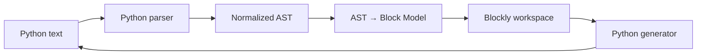
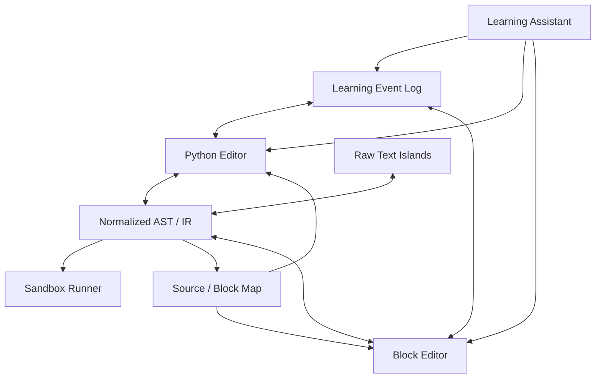

# 직접 설계할 때 가져갈 원칙

> 이 문서는 특정 제품 복제가 아니라 조사 결과를 종합한 권고안입니다.

# 1. 가장 먼저 정할 것: 왜 양방향인가?

목표가 다르면 architecture도 달라집니다.

## 목표 A — 코드 보기
블록으로 코딩하고 Python을 참고만 함.

→ Blockly generator만으로 충분.

## 목표 B — 블록에서 Python으로 졸업
학생이 점점 text를 더 많이 씀.

→ VEX Switch + generated preview.

## 목표 C — 어느 쪽에서든 자유롭게 편집
블록과 Python이 동등한 editor.

→ parser/decompiler 필수.

## 목표 D — 여러 언어/하드웨어
Blocks, TS, Python, devices.

→ PXT식 semantic core가 적합.

---

# 2. 초등·중등용이라면 추천 architecture

Python 중심 서비스라면 처음부터 PXT급 compiler를 만들 필요는 없습니다.

## 권장 v1



### 반드시 추가
- raw text block
- comments
- line/source map
- conversion diagnostics
- block JSON persistence
- shared undo command log

---

# 3. canonical은 Python AST 또는 normalized IR 추천

BlockMirror는 code string을 공유 중심으로 둡니다. 작은 시스템에는 좋습니다.

하지만 장기적으로는:

```ts
interface ProgramIR {
  nodes: Node[];
  comments: Comment[];
  sourceMap: SourceMap;
  unsupportedRegions: RawRegion[];
}
```

같은 normalized AST/IR을 canonical로 두는 편이 강합니다.

왜냐하면:
- block renderer
- Python printer
- execution
- learning analysis

가 같은 의미 구조를 볼 수 있기 때문입니다.

---

# 4. UI state는 별도 저장

semantic IR에 block x/y를 억지로 넣지 않습니다.

```ts
interface BlockViewState {
  blockPositions: Record<NodeId, {x:number; y:number}>;
  collapsed: string[];
  zoom: number;
  scrollX: number;
  scrollY: number;
}
```

MakeCode의 roundtrip처럼 semantic 의미가 같아도 block ID가 바뀔 수 있다는 문제를 줄이려면 **stable semantic node ID**를 자체적으로 만들어야 합니다.

---

# 5. Text Island는 처음부터 설계

완벽한 Python coverage는 현실적으로 늦습니다.

따라서 unsupported code:

```python
[x*x for x in values if x > 0]
```

가 나오면:

```
[ Python 코드 ]
[x*x for x in values if x > 0]
```

처럼 raw node로 보존.

## raw node에 저장할 것
- original source
- start/end location
- parser diagnostics
- expected context: expression/statement
- last successful AST
- convert-back eligibility

---

# 6. "변환 버튼"보다 correspondence가 중요

필수 UX:
- block hover → Python line highlight
- Python cursor → block highlight
- run trace → 양쪽 highlight
- error → 양쪽 표시
- variable rename → 양쪽 동시
- representation switch → same semantic node 중심으로 scroll

학생은 변환 결과보다 **대응 관계**에서 더 많이 배웁니다.

---

# 7. VEX식 점진 전환을 넣어라

전체 mode switch만 두지 말고:

- 이 block만 Python으로
- 이 stack만 Python으로
- 이 function만 Python으로
- 전체 Python으로

를 지원하면 좋습니다.

그리고 가능한 subset이면:

- Python text island → native blocks

도 제공.

---

# 8. conversion diagnostics를 1급 객체로

```ts
type ConversionDiagnostic = {
  code: "UNSUPPORTED_SYNTAX" | "PARSE_ERROR" | "LOSSY_FORMAT";
  severity: "info" | "warning" | "error";
  range: SourceRange;
  nodeId?: string;
  message: string;
  preservation: "preserved-as-raw" | "blocked" | "lost";
};
```

"변환 실패" 하나로 끝내지 않습니다.

---

# 9. 저장 포맷

권장 project package:

```
project.json
program.ir.json
main.py
blocks.view.json
history.json
assets/
```

또는 web storage라면 동일 logical schema.

### main.py는 export artifact
IR이 canonical이어도 user portability를 위해 항상 readable source를 저장하는 것이 좋습니다.

---

# 10. execution sandbox

교육용 브라우저 Python이면:
- Pyodide
- Skulpt
- server sandbox

등 선택이 필요합니다.

양방향 변환 엔진과 execution engine을 결합하지 말고 interface를 분리합니다.

```ts
interface Runner {
  run(source: string): Promise<RunResult>
}
```

---

# 11. versioning

custom blocks가 바뀌면 예전 project가 깨질 수 있습니다.

각 node에:
- schemaVersion
- blockTypeVersion
- API version

을 두고 migration을 지원해야 합니다.

PXT가 오랜 기간 target/extension을 유지하는 데서 배울 점입니다.

---

# 12. 테스트 전략

최소 CI:

1. parser tests
2. AST→block snapshots
3. block→Python snapshots
4. text→block→text semantic tests
5. block→text→block structural tests
6. raw fallback tests
7. comment tests
8. undo/redo tests
9. performance corpus
10. old project migrations

자세한 케이스는 [Round-trip Benchmark](04-roundtrip-benchmark.md).

---

# 13. 접근성

block drag만 강요하면 motor accessibility 문제가 생깁니다.

필수 고려:
- keyboard block insertion
- keyboard reordering
- searchable command palette
- screen-reader label
- high contrast
- zoom independent of browser
- text-only equivalent workflow

텍스트 모드는 접근성 대안이 될 수도 있지만 "블록을 못 쓰면 텍스트를 써라"로 끝내면 안 됩니다.

---

# 14. 교사용 기능

양방향 editor가 교육적으로 강해지는 지점입니다.

교사는 다음을 볼 수 있습니다.

### representation history
```
Blocks 8분
→ Split 4분
→ Python 2분
→ Blocks 복귀
→ Python 성공
```

### recurring transition error
- colon 누락
- indentation
- variable assignment/equality
- function parameter
- condition nesting

### 과제 설정
- block only
- text preview allowed
- hybrid allowed
- full Python required

즉 같은 문제를 수준별로 scaffold할 수 있습니다.

---

# 15. AI는 변환 엔진으로 쓰지 않는 편이 좋음

핵심 bidirectional conversion은 deterministic해야 합니다.

LLM을:
```
Python → "아마 이런 blocks"
```
에 쓰면:
- 의미 변경
- 비결정성
- reproducibility 부족
- 평가 공정성 문제

가 생깁니다.

## AI의 적합한 역할
- conversion diagnostic 설명
- 학생에게 hint
- unsupported syntax를 지원 syntax로 rewrite 제안
- block/text 대응 설명
- teacher analytics summary

## 원칙
**변환은 parser/compiler, 설명은 AI.**

---

# 16. 가장 추천하는 최종 조합



### 기술
- BlockMirror의 AST mapping
- MakeCode의 semantic/decompiler discipline
- Droplet의 source fidelity 철학

### UX
- BlockPy의 split
- VEX의 partial text islands
- Tinkercad의 graduated transition

### 교육
- BlockPython의 process evidence

이 구조가 현재 조사한 여러 서비스의 강점을 가장 잘 결합합니다.
