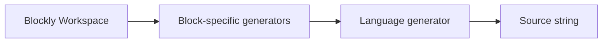

# Blockly — 양방향 변환의 기준점

> 조사 기준일: 2026-11-08  
> 판정: **블록 → 텍스트 generator 프레임워크. 범용 텍스트 → 블록 역변환은 기본 제공하지 않음**  
> 신뢰도: **A**

## 왜 먼저 봐야 하나

많은 교육용 코딩 서비스가 Blockly를 쓰기 때문에 "Blockly가 양방향 변환을 해준다"고 오해하기 쉽습니다.

하지만 공식 문서의 역할 분리는 명확합니다.

1. **Code generation**: workspace의 block을 text code string으로 바꿈
2. **Serialization**: block workspace 자체를 JSON/XML로 저장하고 다시 로드
3. **Text → Blocks parser/decompiler**: 기본 Blockly의 범용 기능으로 제공되는 것이 아님

## 공식 code generation 구조

Blockly 공식 문서가 현재 제공한다고 설명하는 기본 generator:

- JavaScript ES5
- Python 3
- Lua 5.1
- Dart 2
- PHP 7

각 block type마다 언어별 block-code generator를 구현합니다.



핵심은 마지막 결과가 **문자열**이라는 점입니다.

## Serialization은 역변환이 아니다

최신 Blockly 문서는 새 프로젝트에 JSON serialization을 권장합니다.

```js
const state = Blockly.serialization.workspaces.save(workspace);
Blockly.serialization.workspaces.load(state, workspace);
```

이것은:

```
Blockly state → JSON → Blockly state
```

이지,

```
Python/JavaScript text → Blockly
```

가 아닙니다.

### 저장되는 것
- blocks
- variables
- procedures
- custom extra state
- plugin state(등록한 serializer가 있을 때)

### 왜 중요하나
양방향 시스템에서도 block workspace의 **정확한 편집 상태 보존**은 text round-trip과 별도로 저장해야 할 수 있습니다.

예:
- block x/y 좌표
- collapsed
- disabled
- block ID
- custom mutator state

텍스트 코드를 다시 parse하는 것만으로는 이런 정보를 복구하기 어렵습니다.

## 직접 양방향을 만들려면 추가할 것

### 방법 1 — parser + AST + Blockly mapper
BlockMirror 방식.

```
Python → parser → AST → Blockly JSON/XML
Blockly → Python generator
```

### 방법 2 — compiler/decompiler
MakeCode/PXT 방식.

```
Blocks → IR
Text → IR
IR → Blocks
IR → Text
```

### 방법 3 — text overlay
Droplet 방식.

```
original text + structural markup
```

## 장점
- block editor 자체는 매우 성숙
- plugin/serializer 체계가 좋음
- generator 작성이 비교적 쉬움
- custom blocks 생태계가 큼

## 양방향 관점의 한계
- text parser를 제공하지 않음
- 생성된 code의 formatting은 generator가 결정
- text에서 자유롭게 쓴 모든 syntax를 자동 block화할 수 없음
- text와 block의 source position mapping도 애플리케이션이 설계해야 함

## 우리가 가져갈 점

Blockly를 쓴다면 다음을 분리 저장하는 편이 안전합니다.

```ts
type Project = {
  canonicalCodeOrIR: ...;
  blockWorkspaceState: ...;
  conversionMetadata: {
    sourceMap: ...;
    unsupportedRegions: ...;
    version: ...;
  };
}
```

즉 **실행 의미 상태**와 **블록 편집기 UI 상태**를 같은 것으로 취급하지 않습니다.

## Sources

- Blockly Code generation  
  https://docs.blockly.com/guides/create-custom-blocks/code-generation/overview/
- Blockly Save and load / serialization  
  https://docs.blockly.com/guides/configure/serialization/
- Blockly GitHub  
  https://github.com/RaspberryPiFoundation/blockly
