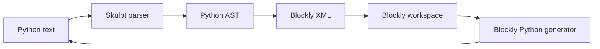

# BlockPy / BlockMirror

> 조사 기준일: 2026-11-08  
> 판정: **Python ↔ Blockly를 직접 연구할 때 가장 실용적인 오픈소스 참고 구현**  
> 왕복 수준: **Python subset S3~S4**  
> 신뢰도: **A**

## 1. BlockPy와 BlockMirror 관계

BlockPy는 학습 환경이고, BlockMirror는 dual block/text editor 핵심을 분리한 라이브러리입니다.

BlockPy 공식 소개:
- web-based Python
- blocks
- text
- both(split view)

를 지원합니다.

BlockMirror를 보면 실제 양방향 동기화 방식을 코드 단위로 이해할 수 있습니다.

## 2. 화면 구조

BlockMirror configuration의 `viewMode`:

- `split`
- `block`
- `text`

split에서는 넓은 화면 기준:
- block side 약 60%
- text side 약 40%

작은 화면에서는 상하 배치로 바뀝니다.

즉 dual-modality를 단순 tab toggle이 아니라 **동시에 비교하는 학습 도구**로 설계했습니다.

## 3. canonical state

`BlockMirror`에는 공유 문자열:

```js
this.code_ = "";
```

가 있습니다.

`setCode(code)`는:
1. `code_` 갱신
2. block editor에 같은 code 전달
3. text editor에 같은 code 전달
4. change listener 발생

따라서 Python source string이 전체 동기화의 핵심 상태입니다.

## 4. Python → Blocks

`src/text_to_blocks.js`

핵심 흐름:

```js
parse = Sk.parse(filename, python_source);
ast = Sk.astFromParse(parse.cst, filename, parse.flags);
converted = this.convert(ast);
```

즉:

```
Python source
  ↓
Skulpt parser
  ↓
Python AST
  ↓
node별 converter
  ↓
Blockly XML
```

입니다.

## 5. AST node별 mapping

`src/ast/`에 각 Python AST construct에 대응하는 구현이 분리됩니다.

새 AST type을 추가하려면 보통:
1. Blockly block definition
2. Blockly → Python generator
3. Skulpt AST → Blockly 변환

세 부분이 필요합니다.

이 구조는 작은 팀이 유지보수하기에도 이해하기 쉽습니다.

## 6. Blocks → Python

block editor:

```js
python.pythonGenerator.workspaceToCode(this.workspace)
```

를 사용합니다.

즉 이 방향은 표준 Blockly generator 모델입니다.

전체 그림:



## 7. 매우 좋은 실패 처리: raw code block

텍스트가 syntax error를 포함할 때 전체 변환을 포기하지 않습니다.

`convertSource`는:
- parse가 실패한 line 근처를 감지
- 가능한 앞쪽 chunk를 계속 parse
- 실패 부분을 `raw_block`으로 추가

합니다.

즉:

```
valid Python + unsupported/broken chunk
```

를

```
normal blocks + raw source block
```

으로 보존할 수 있습니다.

### 교육적으로 좋은 이유
학생의 코드가 일시적으로 incomplete한 동안 block 화면이 통째로 사라지지 않습니다.

일반 IDE에서 typing 중인 코드는 순간순간 syntax error 상태이기 때문에 이 fallback은 매우 중요합니다.

## 8. comments

parser가 제공하는 comment 위치를 별도 map으로 추적하고, AST node 사이에서 comment block으로 변환합니다.

comments를 무시하면:
- 학생의 설명
- 과제 scaffold
- teacher feedback marker

가 왕복 시 사라질 수 있습니다.

## 9. line mapping

BlockMirror는 source line을 측정하고 block XML에 line number를 연결합니다.

이를 이용해 block y-coordinate ordering도 조정합니다.

확장하면:
- 실행 줄 highlight
- text cursor ↔ block highlight
- 오류 위치 ↔ block
에 사용할 수 있습니다.

## 10. sync loop 방지

코드에 다음 상태가 있습니다.

- `silenceBlock`
- `silenceText`
- `silenceModel`
- timer / delayed update
- `outOfDate_`

이는 split editor에서 매우 실전적인 패턴입니다.

### 왜 필요한가

```
text edit
→ blocks reload
→ Blockly change
→ Python regenerate
→ text set
→ text change
→ ...
```

를 막아야 하기 때문입니다.

## 11. 성능

configuration에 `blockDelay`가 있습니다.

README에서도 긴 파일은 parse에 시간이 걸릴 수 있으므로 block update를 delay/consolidate하는 옵션이라고 설명합니다.

즉 full reparse 구조의 비용을 이미 인지하고 있습니다.

## 12. 장점

- Python에 집중한 구조라 이해하기 쉬움
- 실제 text→AST→blocks 구현이 공개
- raw fallback
- split view
- line mapping
- change-loop guard
- custom block 확장 경로가 명료

## 13. 한계

### Python parser 버전 의존
Skulpt parser와 Python 문법 지원 범위가 핵심 병목.

### full reparse 성격
프로그램이 커지면 incremental parsing이 필요해질 수 있음.

### source formatting
blocks에서 Python으로 다시 생성하면 원래 사용자가 쓴 formatting과 정확히 같지 않을 수 있음.

### 동적 Python의 애매함
BlockPy 소개에서도 지적하듯:
- `[]`가 list indexing인지 dictionary indexing인지
- runtime type이 무엇인지

같은 동적 언어 특성이 visual representation을 어렵게 만듭니다.

## 14. 현재 유지보수 판단

BlockMirror core 공개 repo의 최근 큰 업데이트는 2025-03에 Blockly 11.2.1 반영 등이 확인됩니다.

BlockPy organization 자체는 2026년에도 다른 repo들이 업데이트되고 있습니다.

따라서:
- architecture 참고: 매우 높음
- 그대로 dependency로 넣을 때: 현재 version/maintenance를 따로 검증

이 적절합니다.

## 15. 새 Python 교육도구를 만든다면

가장 현실적인 출발점입니다.

### 1차 버전
```
Python source canonical
+ Blockly
+ parser AST mapping
+ raw code block
```

### 2차 버전
- incremental parse
- source map
- block/text simultaneous selection
- syntax error region만 raw block
- semantic diff
- undo stack 통합

### 3차 버전
- type inference
- library API metadata
- custom data/sensor blocks
- execution trace 양쪽 highlight

## Sources

- BlockPy  
  https://blockpy.cis.udel.edu/
- BlockPy GitHub  
  https://github.com/blockpy-edu/blockpy
- BlockMirror GitHub  
  https://github.com/blockpy-edu/BlockMirror
- BlockMirror README  
  https://github.com/blockpy-edu/BlockMirror/blob/master/README.md
- Python → Blocks  
  https://github.com/blockpy-edu/BlockMirror/blob/master/src/text_to_blocks.js
- shared model  
  https://github.com/blockpy-edu/BlockMirror/blob/master/src/block_mirror.js
- block editor  
  https://github.com/blockpy-edu/BlockMirror/blob/master/src/block_editor.js
