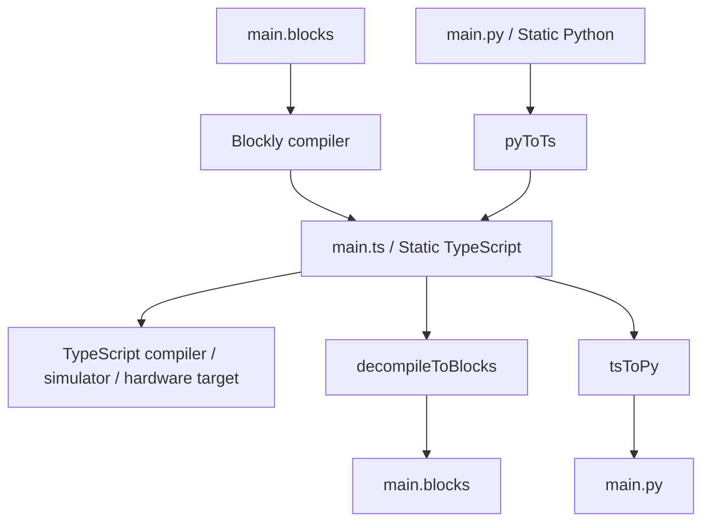

# Microsoft MakeCode / PXT

> 조사 기준일: 2026-11-08  
> 판정: **현재 가장 참고 가치가 높은 compiler/decompiler형 블록↔텍스트 시스템**  
> 왕복 수준: **S4 의미 왕복에 가까움. 단, 지원 언어 subset/target에 의존**  
> 신뢰도: **A**

## 1. 사용자 경험

MakeCode는 editor에 따라 다음 표현을 제공합니다.

- Blocks
- Static TypeScript / JavaScript-style editor
- Static Python — target이 지원하는 경우

공식 언어 문서는 **Blocks와 Static Python이 Static TypeScript로 변환된 뒤 컴파일**된다고 명시합니다.

일부 target에서 Python은 아직 실험 기능일 수 있으므로 "모든 MakeCode 제품에서 Python 양방향"으로 일반화하면 안 됩니다.

## 2. 저장 파일 구조

PXT source에서 다음 상수가 직접 확인됩니다.

```ts
MAIN_BLOCKS = "main.blocks"
MAIN_TS     = "main.ts"
MAIN_PY     = "main.py"
```

그리고 preferred editor도:
- blocksprj
- tsprj
- pyprj

로 구분합니다.

중요한 점은 **표현마다 파일을 별도로 가질 수 있다는 것**입니다. 단순히 한 문자열을 탭별로 렌더링하는 구조가 아닙니다.

## 3. 핵심 변환 파이프라인



### Python → TypeScript
PXT `transpile.ts`:

- `pyToTs(...)`
- 내부 Python subsystem의 `py2ts` 사용

### TypeScript → Python
같은 파일:

- `tsToPy(...)`
- `decompileToPython` 호출

### TypeScript → Blocks
`pxtcompiler/emitter/decompiler.ts`의 `decompileToBlocks`.

이 decompiler는:
- arithmetic
- comparison
- boolean
- calls
- events
- variables
- comments
- mutation metadata
- block fields

등을 Blockly node로 다시 구성합니다.

## 4. 왜 Static TypeScript가 핵심인가

N개의 표현 사이를 직접 변환하지 않습니다.

나쁜 확장:

```
Blocks ↔ Python
Blocks ↔ JavaScript
Python ↔ JavaScript
...
```

PXT식:

```
Blocks ─┐
Python ─┼→ Static TypeScript semantic core → target
Text  ──┘
```

그리고 필요할 때 core에서 각 표현으로 decompile합니다.

### 장점
- device API의 type information을 중앙에서 관리
- extension/custom block annotation을 compiler가 이해
- diagnostics와 source map을 공통화
- simulator/compiler도 같은 의미 계층 사용

## 5. API metadata가 변환 품질을 결정

MakeCode의 블록은 단순히 JavaScript 문장을 색칠한 것이 아닙니다.

API declaration에 block 관련 metadata를 붙여:
- 어떤 함수가 block이 되는지
- category
- parameter field
- fixed instance
- enum/kind
- decompiler behavior

등을 정의합니다.

따라서 **아무 TypeScript나 완벽히 블록화하는 범용 decompiler가 아니라, MakeCode가 정의한 교육용 언어와 API subset을 안정적으로 왕복**하는 시스템입니다.

## 6. unsupported syntax와 grey block

PXT source에는 "grey block" 개념이 존재합니다.

예를 들어 field editor가 어떤 decompiled argument를 정상 block field로 해석하지 못하면 **코드 문자열을 보존한 grey block**으로 렌더링할 수 있습니다.

이 설계의 목적은:

```
표현 불가 → 삭제
```

가 아니라

```
표현 불가 → text island로 보존
```

입니다.

이는 양방향 editor의 가장 중요한 안전장치 중 하나입니다.

## 7. comments

Decompiler source는:
- single-line comment
- multi-line comment
- trailing comment
- empty line 관계

를 별도 구조로 추적합니다.

단순 generator만 만들면 놓치기 쉬운 부분입니다.

## 8. round-trip이 "동일성"을 뜻하지는 않음

PXT의 block diff 코드에는 Blocks → TS roundtrip에서 **block ID가 모두 바뀔 수 있다**는 취지의 주석이 있습니다.

따라서 세 수준을 구분해야 합니다.

1. 실행 의미 동일
2. block tree 구조 유사
3. block object ID/배치까지 동일

MakeCode는 1을 가장 중시하고, 2를 높은 수준으로 복원하지만 3은 항상 보장하지 않습니다.

## 9. Python도 직접 Blocks와 연결되는 게 아니다

개념적으로:

```
Python → TypeScript → Blocks
```

입니다.

이게 중요한 이유:
- Python parser와 block decompiler를 직접 서로 맞추지 않아도 됨
- Python과 TypeScript의 의미 차이는 py2ts 계층에서 처리
- Blocks 표현 가능성은 TS decompiler 한 곳에서 제어

## 10. UX 관점 장점

### Language Toggle
초보자는 동일한 프로그램을 Blocks / JavaScript / Python 관점에서 비교할 수 있습니다.

### Docs도 같은 변환 엔진 사용
PXT 문서는 JavaScript snippet을 Blocks 또는 Python으로 렌더링할 수 있습니다.

즉 변환기는 editor 전환뿐 아니라:
- tutorial
- documentation
- sample rendering

에도 재사용됩니다.

## 11. 한계 / 위험

### 언어 전체 지원 착각
Static TypeScript는 일반 TypeScript 전체가 아니며, Static Python도 일반 CPython 전체를 의미하지 않습니다.

### extension metadata 의존
좋은 custom block round-trip을 위해 extension author가 annotation을 정확히 작성해야 합니다.

### 시각 상태 손실
block 위치, ID 등의 UI identity는 semantic round-trip과 별도 문제.

### 복잡도
compiler, Python transpiler, decompiler, Blockly compiler가 모두 있으므로 자체 구현 비용이 매우 큼.

## 12. 우리 서비스에 가져갈 설계

### 반드시 가져올 것
- 공통 semantic core
- source map
- unsupported syntax 보존
- decompiler test suite
- API metadata-driven block definition
- 표현별 파일/상태 versioning

### 규모가 작다면 그대로 복제하지 말 것
Python 한 언어만 필요한 서비스에서 PXT 전체 구조는 과도합니다. 이 경우 BlockMirror식 AST mapping이 더 현실적입니다.

## 13. 추천 테스트

```
Blocks → TS → Blocks
Python → TS → Python
Python → TS → Blocks → TS
Blocks → TS → Python → TS
```

각 테스트에서:
- semantic result
- comments
- custom API calls
- unsupported expressions
- variable renaming
- functions
- nested events
를 비교해야 합니다.

## Source inspection

- PXT repository  
  https://github.com/microsoft/pxt
- main file constants  
  https://github.com/microsoft/pxt/blob/master/pxtlib/main.ts
- TypeScript → Blocks decompiler  
  https://github.com/microsoft/pxt/blob/master/pxtcompiler/emitter/decompiler.ts
- Python ↔ TypeScript transpilation  
  https://github.com/microsoft/pxt/blob/master/pxtcompiler/emitter/transpile.ts
- compiler driver  
  https://github.com/microsoft/pxt/blob/master/pxtcompiler/emitter/driver.ts
- MakeCode language architecture  
  https://makecode.com/language
- MakeCode language toggle description  
  https://makecode.com/blog/minecraft/python-release
- PXT documentation snippets  
  https://makecode.com/writing-docs/snippets
