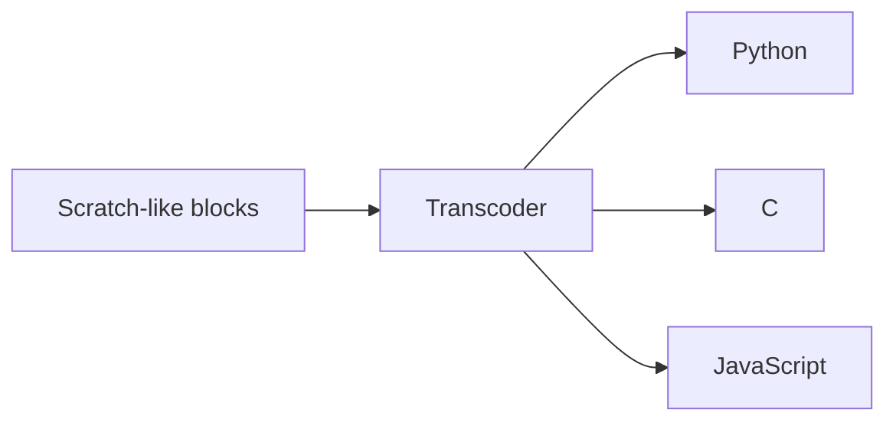

# mBlock 5

> 조사 기준일: 2026-11-08  
> 판정: **블록과 Python을 모두 강하게 지원하지만, 현재 확인된 일반 구조는 block→Python 표시/전환 + 별도 Python editor 쪽이 중심**  
> 신뢰도: **B**

## 1. 현재 제품 상태

공식 사이트는 mBlock을:
- Code with Block
- Code with Python
- "Switch from Block-based to Python"

으로 소개합니다.

웹 버전과 PC 버전이 있고, PC 최신 공개 버전은 현재 페이지 기준 V5.6.0(2025-04-08)입니다.

## 2. 제품이 하나의 변환 방식만 쓰지 않음

mBlock은:
- sprite coding
- CyberPi
- mBot2
- Codey Rocky
- 기타 hardware

등 대상이 많습니다.

따라서 "mBlock의 Python 전환"을 하나의 규칙으로 일반화하면 부정확합니다.

특히:
- Live mode
- Upload mode
- device별 Python API
- separate Python Editor

가 섞여 있습니다.

## 3. 공식 문서에서 확인되는 block→Python

CyberPi/mBot 계열 도움말은 Upload mode에서:
- block programming
- Python programming
- block에 대응하는 Python statements 보기

를 제공합니다.

또 developer/help 문서에는 Upload mode에서 block script를:
- Python
- C
- JavaScript

statement로 **transcoding**할 수 있다고 설명합니다.

즉 최소 구조:



가 존재합니다.

## 4. Python editor

공식 문서는 Python Editor 접근을 여러 방식으로 설명합니다.

예: CyberPi 계열에서
1. block editing 화면에서 Python code 확인
2. Python tab
3. 별도 Python Editor

제품 사이트도:
- block 시작
- Python mode preview
- Python IDE로 text coding

이라는 단계로 설명합니다.

## 5. 역변환 판정

현재 공식 자료에서 명확하게 확인한 것은:
- block→Python generation/view
- generated Python 직접 편집이 가능한 경우
- separate Python IDE

입니다.

**임의로 수정한 Python을 다시 동일 Scratch-like block tree로 복구한다는 일반 기능은 확인하지 못했습니다.**

기존 연구도 mBlock을 read-only one-way 계열로 분류한 바 있습니다. 다만 제품이 이후 변했으며 device별 behavior도 다르므로 현재는:

> "제품 전체가 역변환 불가"라고 단정하기보다, **일반적인 true round-trip 근거가 부족하다**

라고 기록하는 것이 정확합니다.

## 6. Transcoding template 구조가 흥미로운 점

공식 "Transcoding Setting for Upload Mode" 문서는 Python template 예를 보여줍니다.

개념적으로:

```
imports
libraries
variables
generated code
```

를 template slot에 삽입합니다.

즉 block language와 hardware runtime 사이에 **target별 code emission layer**를 둡니다.

### 장점
hardware extension author가:
- code header
- library import
- variable setup
- emitted body

를 통제할 수 있습니다.

### 단점
generator architecture이므로 arbitrary text→block과는 별개입니다.

## 7. UX의 강점

### 하드웨어 문맥과 즉시 연결
학생이 block으로 hardware를 움직인 뒤 대응 Python API를 바로 볼 수 있습니다.

### 여러 단계의 전환
- block only
- corresponding Python preview
- Python editing
- Python IDE

로 넘어가는 구조가 있어 "한 번에 text IDE"보다 부담이 낮습니다.

### block search / disable
2025 V5.6.0에서 block search, block disable 등이 추가되어 큰 block project 관리도 개선되었습니다.

## 8. 한계

### mode/device fragmentation
같은 제품 안에서도 특정 기능이 특정 hardware / Upload mode에서만 제공될 수 있습니다.

### true round-trip 불명확
텍스트 수정 이후 block 복원이 핵심 요구라면 mBlock UX를 그대로 모델로 삼으면 안 됩니다.

### 두 editor의 문맥 연속성
Python IDE로 넘어갔을 때:
- block positions
- teaching hints
- execution history
- block annotations

같은 정보가 얼마나 이어지는지 별도 검토가 필요합니다.

## 9. 가져갈 설계

### 좋은 것
- hardware API를 실제 Python statements로 보여주기
- preview 단계를 둔 뒤 full text IDE로 전환
- target-specific transcoding template
- block search
- block disable

### 양방향 서비스라면 보완할 것
- Python edit가 block representability를 깨는 순간 즉시 표시
- "돌아가기 가능/불가" 상태 badge
- conversion diff
- unsupported Python을 raw text block으로 보존

## Sources

- mBlock current product  
  https://mblock.cc/
- Downloads / current PC version  
  https://mblock.cc/pages/downloads
- Python Editor usage  
  https://support.makeblock.com/hc/en-us/articles/15958180894999-16-How-to-Use-the-Python-Editor-in-mBlock-5
- Upload mode transcoding  
  https://support.makeblock.com/hc/en-us/articles/15236617061783-Configuration-Transcoding-Setting-for-the-Upload-Mode
- mBot Neo block/Python guidance  
  https://support.makeblock.com/hc/en-us/articles/1500006184281-Program-mBot-Neo-with-mBlock-5
- Update history  
  https://support.makeblock.com/hc/en-us/articles/14778939402135-mBlock-5-Update-History
