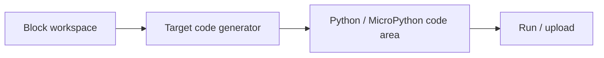

# Mind+ (DFRobot)

> 조사 기준일: 2026-11-08  
> 판정: **블록→코드 자동 생성과 텍스트 편집을 강하게 지원하지만, 현재 공개 근거상 arbitrary text→native blocks 역변환은 확인되지 않음**  
> 분류: **editable one-way / block+code hybrid workspace**  
> 신뢰도: **B**

## 1. 현재 제품 방향

Mind+ 공식 사이트는 현재 제품을 "All-in-One Coding & AI Creation Platform"으로 소개하며 Coding Model에서:

- block-based programming
- blocks auto-generate code
- multiple boards / hardware modules
- real-time interaction / upload

을 핵심으로 설명합니다.

즉 블록을 단순 초급용 표현으로 끝내지 않고 **같은 작업 공간에서 실제 코드와 연결하는 것**이 제품 철학에 들어가 있습니다.

## 2. 사용자 경험의 핵심

DFRobot의 Mind+ Python/하드웨어 튜토리얼은 다음 흐름을 반복해서 보여줍니다.

```
Blocks
  ↓ drag/drop
Code text area
  ↓ automatically generated
Python / MicroPython
```

일부 MicroPython 관련 문서에서는 code display area를:
- automatic generation
- manual editing

두 방식으로 사용할 수 있다고 설명합니다.

따라서 단순 read-only preview보다 한 단계 더 나아간 **editable generated code** 경험이 존재합니다.

## 3. 그러나 이것을 '양방향'이라고 부르면 안 됨

현재 공식 자료에서 확인되는 것은:

1. block 조작
2. 대응 code 자동 생성
3. code 영역 표시
4. 일부 모드에서 code 직접 편집

입니다.

확인되지 않은 것은:

> 사용자가 임의로 수정한 Python/MicroPython code를 parse하여 원래 native block tree로 다시 구성하는 기능

입니다.

따라서 이 저장소에서는 **S2 editable one-way**로 분류합니다.

## 4. 교육적 장점

### 즉각적인 syntax correspondence
블록을 끌어놓자마자 Python이 보이면:
- 함수 이름
- argument
- indentation
- variable assignment

을 바로 연결할 수 있습니다.

### hardware와 직접 연결
학생이 "이 Python 문법이 실제 보드에서 무엇을 하는지" 즉시 확인할 수 있습니다.

### 생성 코드가 숨겨진 내부 산출물이 아님
실제 text area에 노출된다는 점이 좋습니다.

## 5. 기술 구조에서 보이는 패턴

DFRobot 문서의 설명을 그대로 구조화하면:



하드웨어마다:
- import
- board library
- initialization
- API call

이 달라지므로 target-specific generator/template 계층이 필요합니다.

## 6. 장점

- 블록과 실제 코드 간 거리가 짧음
- hardware API 학습에 적합
- 코드가 실시간으로 생성됨
- 하나의 제품에서 여러 board/module을 다룸
- GUI/AI/hardware와 coding을 한 workflow로 묶음

## 7. 한계

### 역변환 근거 없음
Python을 고친 뒤 native block으로 되돌리는 기능은 공식 문서에서 확인되지 않았습니다.

### canonical state가 갈릴 위험
manual edit를 허용하는 순간:
- block state
- text state

중 무엇이 진짜 프로그램인지 UX가 명확해야 합니다.

### target fragmentation
보드와 runtime에 따라 generated code 형태가 달라집니다.

## 8. 우리가 가져갈 것

### 좋음
- block edit 즉시 code line update
- hardware block ↔ actual API call correspondence
- code preview를 별도 "학습 패널"처럼 상시 제공

### 양방향으로 발전시키려면
- text parse layer
- supported subset 표시
- unsupported text island
- block/text correspondence map
- text edit 후 "blocks로 복원 가능" badge

가 필요합니다.

## Sources

- Mind+ official  
  https://mindplus.cc/en/
- DFRobot Mind+ hardware tutorial — blocks generate code in text box  
  https://wiki.dfrobot.com/rob0182/docs/23131
