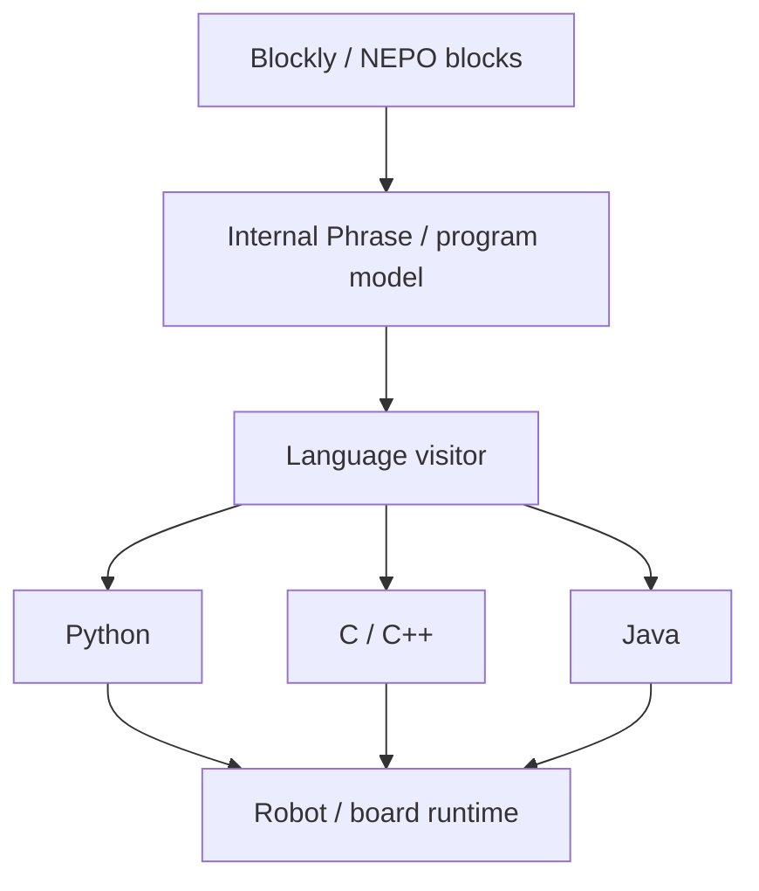

# Open Roberta Lab

> 조사 기준일: 2026-11-08  
> 판정: **Blockly/NEPO program representation에서 robot별 Python/Java/C/C++를 생성하는 강력한 multi-target code generation architecture. 범용 text→blocks round-trip 도구는 아님**  
> 분류: **generator / compiler pipeline**  
> 신뢰도: **A** — 공식 서비스 + 공개 core source 확인

## 1. 왜 분석 가치가 높은가

Open Roberta Lab은 Fraunhofer IAIS의 완전 오픈소스 교육용 robot programming platform입니다.

현재 Lab은:
- graphical NEPO programming
- Python
- Java
- C/C++
- simulation
- 다양한 robot/board

를 다룹니다.

이 서비스의 강점은 **양방향 변환 자체가 아니라 하나의 visual program representation을 수많은 hardware target의 실제 언어로 안정적으로 code generation**하는 데 있습니다.

## 2. 공개 저장소

`OpenRoberta/openroberta-lab`

현재 저장소는:
- OpenRobertaRobot
- OpenRobertaServer
- OpenRobertaWeb
- RobotMbed
- RobotSpike
- RobotCyberpi
- RobotEV3
- RobotNAO
- ...

처럼 core와 target plugin을 크게 분리합니다.

Blockly도 별도 OpenRoberta Blockly repository/build를 사용합니다.

## 3. code generation architecture

GitHub source에서 공통 Python generator:

```
OpenRobertaRobot/
  visitor/lang/codegen/prog/
    AbstractPythonVisitor.java
```

를 확인할 수 있습니다.

그리고 target별로:

- `MicrobitPythonVisitor`
- `SpikePythonVisitor`
- `Mbot2PythonVisitor`
- `Ev3PythonVisitor`
- `NaoPythonVisitor`
- `EdisonPythonVisitor`

등이 상속/확장합니다.

`SpikePythonVisitor` 설명은 program phrase를 **human-readable, correct Python code**로 StringBuilder에 출력한다고 명시합니다.

즉 개념적으로:



입니다.

## 4. PXT와 비슷하면서도 다른 점

### 공통
- visual program을 중간 의미 구조로 해석
- target별 generator
- hardware API abstraction
- 큰 test/build system

### 차이
MakeCode/PXT는 text→semantic core→blocks **decompiler**까지 핵심 제품 경험으로 가지고 있습니다.

Open Roberta에서 공개적으로 두드러지는 것은:
- NEPO/phrase model
- language visitor
- source generation
- compile/upload

입니다.

**임의 Python/Java/C++ source를 parse하여 기존 NEPO block tree로 되돌리는 일반 decompiler는 현재 확인하지 못했습니다.**

## 5. comments까지 source generation

Open Roberta help는 visual `comment` block의 내용이 **generated source code에도 표시**된다고 명시합니다.

이는 generator 품질에서 중요한 포인트입니다.

블록→텍스트는 실행 가능한 코드만 만드는 것이 아니라:
- comments
- naming
- readable layout

을 함께 유지해야 교육적으로 유용합니다.

## 6. 흥미로운 text island: eval expression

현재 Open Roberta에는 `eval .. as ...` block이 있고, help는:

> Blockly blocks로 만들 수 있는 거의 모든 expression을 text로도 입력할 수 있다

고 설명합니다.

이것은 완전한 text editor는 아니지만 **visual program 안에 textual expression island를 넣는 hybrid pattern**입니다.

VEX Switch와 비교할 가치가 있습니다.

### 차이
- VEX Switch: Python statement 수준 text island
- Open Roberta eval: expression 수준 text island

## 7. 장점

### multi-target architecture
robot별 code generation 책임을 plugin/visitor에 분리.

### 공개 소스
실제 대규모 educational programming platform의 구조를 볼 수 있습니다.

### hardware abstraction
같은 high-level educational concepts를 다양한 board/runtime에 매핑.

### source readability
단순 machine output이 아니라 사람이 읽을 수 있는 source를 목표로 합니다.

## 8. 한계

### 진짜 block↔text dual editor와는 다름
generated code가 있다고 해서 reverse parser/decompiler가 있는 것은 아닙니다.

### target complexity
지원 board가 늘수록 visitor/runtime compatibility 관리 비용이 큽니다.

### visual AST와 source language의 표현력 차이
일반 Python/C++ 전체를 native NEPO block vocabulary로 되돌리는 것은 별도의 문제입니다.

## 9. 우리가 가져갈 것

하드웨어 코딩 서비스를 만든다면 Open Roberta의 구조가 매우 참고됩니다.

추천 분리:

```
core educational AST
├─ block renderer
├─ Python generator
├─ C++ generator
├─ simulator adapter
└─ hardware target adapters
```

그리고 만약 양방향까지 만들고 싶다면 여기에:

```
Python parser → core AST
```

를 추가하고, core AST로 표현되지 않는 syntax는 raw text node로 보존해야 합니다.

## Sources

- Open Roberta Lab  
  https://lab.open-roberta.org/
- Open Roberta GitHub  
  https://github.com/OpenRoberta/openroberta-lab
- Common Python visitor  
  https://github.com/OpenRoberta/openroberta-lab/blob/develop/OpenRobertaRobot/src/main/java/de/fhg/iais/roberta/visitor/lang/codegen/prog/AbstractPythonVisitor.java
- Spike Python generator  
  https://github.com/OpenRoberta/openroberta-lab/blob/develop/RobotSpike/src/main/java/de/fhg/iais/roberta/visitor/spike/SpikePythonVisitor.java
