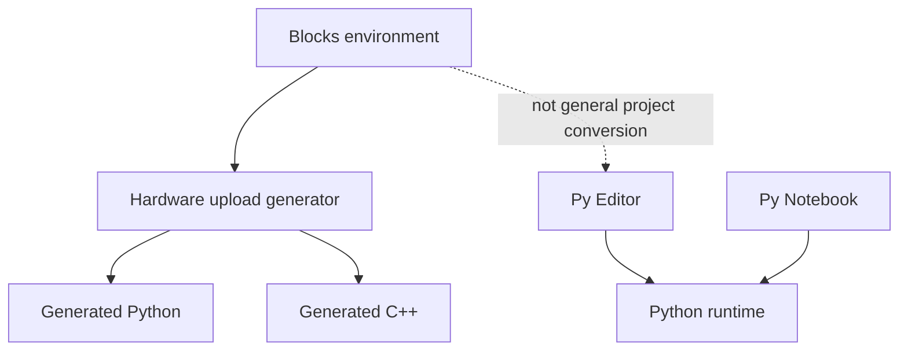

# PictoBlox

> 조사 기준일: 2026-11-08  
> 판정: **block coding과 Python/C++ text coding을 모두 제공하지만, 동일 프로젝트의 general round-trip보다는 separate environments + hardware upload transcoding 구조**  
> 분류: **parallel/progressive modalities + one-way block→syntax conversion**  
> 신뢰도: **B**

## 1. 현재 제품 구조

현재 PictoBlox는 coding environment를 명확히 분리해 제공합니다.

- Junior Blocks — 4+
- Blocks — 7+
- Py Editor — 12+
- Py Notebook — 12+
- Embedded C++ — 12+ beta
- AI / ML / 3D·XR 등

즉 제품 레벨에서는 **block과 text를 모두 강하게 지원**하지만 같은 editor의 단순 언어 토글과는 다릅니다.

## 2. 공식 FAQ의 중요한 답

STEMpedia 공식 PictoBlox troubleshooting은:

> Block coding을 syntax-based coding으로 바꿀 수 있는가?

에 대해 하드웨어 programming에서는:
- block → Python
- block → C++

으로 변환할 수 있다고 설명합니다.

그러나 동시에:

> block code won’t convert into the Python environment

이라고 명시합니다.

이 문장이 중요합니다.

즉 **upload용 source generation**과 **Python learning environment로의 project migration**은 다른 기능입니다.

## 3. 구조



따라서 "Python을 지원한다" 또는 "block이 Python으로 바뀐다"는 설명만 보고 양방향으로 분류하면 틀립니다.

## 4. 교육적 progression

PictoBlox는 연령별 environment 자체가 scaffold입니다.

```
Junior Blocks
→ Blocks
→ Py Editor / Py Notebook
→ Embedded C++
```

이 구조는 LEGO SPIKE와 비슷하게 **동일 AST 왕복보다 학습 단계에 따른 환경 전환**을 택한 사례입니다.

## 5. 장점

### 연령별 entry point가 분명
4+, 7+, 12+로 coding environment를 명시적으로 나눕니다.

### text coding도 주변부 기능이 아님
Py Editor와 Py Notebook이 독립된 1급 environment입니다.

### hardware upload code generation
블록과 실제 Python/C++ API를 연결할 수 있습니다.

### AI/robotics와 함께 사용
학생이 text coding을 실제 project context로 이어갈 수 있습니다.

## 6. 한계

### same-project roundtrip이 아님
공식 FAQ가 block code가 Python environment로 변환되지 않는다고 명시합니다.

### 표현 전환의 continuity가 약할 수 있음
Blocks에서 작성한 특정 project를 그대로 Py Editor에서 이어서 수정하는 경험이 제한됩니다.

### 생성 코드와 학습용 Python editor를 혼동하기 쉬움
UI/교육 안내에서:
- generated upload code
- editable Python project

를 분리해 설명해야 합니다.

## 7. 우리가 가져갈 것

양방향 시스템을 만들더라도 PictoBlox의 **연령/수준별 workspace simplification**은 가치가 있습니다.

예:
- 1단계: junior block vocabulary
- 2단계: full blocks
- 3단계: blocks + Python
- 4단계: Python editor
- 5단계: notebook / advanced library

기술적 core는 공유하되 UI complexity를 단계별로 열 수 있습니다.

## Sources

- PictoBlox current environment selection  
  https://test.pictoblox.ai/
- PictoBlox official troubleshooting — block→Python/C++ for hardware, not Python environment  
  https://ai.thestempedia.com/docs/pictoblox/pictoblox-tutorials/pictoblox-block-coding-troubleshooting/
- PictoBlox product page  
  https://thestempedia.com/PROduct/pictoblox/
