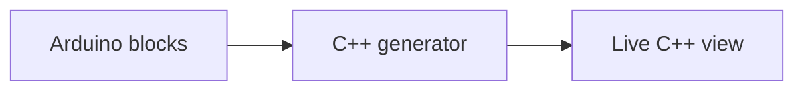

# Tinkercad Circuits — Arduino Blocks / Blocks + Text / Text

> 조사 기준일: 2026-11-08  
> 판정: **블록→C++ 실시간 대응은 매우 좋은 교육 UX지만, pure Text 전환은 사실상 one-way**  
> 신뢰도: **B**

## 1. 현재 제품

Tinkercad Circuits는 현재도:
- Arduino
- micro:bit
- virtual electronics simulation
- Codeblocks

를 제공합니다.

Arduino coding에서 널리 쓰이는 모드는:
- Blocks
- Blocks + Text
- Text

입니다.

## 2. Blocks + Text

공식 Tinkercad Circuits guide는:
- block code에서 C++를 자동 생성
- Blocks + Text에서 대응 C++ 표시
- block 변경이 text view에 즉시 반영

된다고 설명합니다.



이 UX는 **동일한 logic을 visual syntax와 real Arduino syntax로 나란히 비교**하는 데 매우 좋습니다.

## 3. pure Text로 넘어가는 순간

공식 가이드는 학생이 준비되면 pure Text view로 이동해 Arduino IDE와 유사하게 직접 C++를 작성할 수 있다고 설명합니다.

여러 교육 자료와 기존 연구에서 이 전환은 irreversible one-way로 다뤄집니다.

즉:
- Blocks ↔ Blocks + Text: block state 유지
- Blocks/Blocks+Text → Text: 가능
- freely edited Text → original Blocks: 일반적으로 복구하지 않음

으로 이해하는 것이 안전합니다.

## 4. 이 설계가 합리적인 이유

C++ 전체를 Arduino block set으로 역변환하려면:
- preprocessor
- libraries
- pointers/references
- classes
- arbitrary function
- macro
- low-level syntax

까지 다뤄야 합니다.

교육용 Arduino block vocabulary는 이 전체 언어보다 훨씬 작습니다.

따라서 Tinkercad는 **언어 전체 decompiler를 만들기보다 학습자가 block에서 text로 졸업하도록** 설계한 셈입니다.

## 5. 교육적 강점

### hardware 결과가 동일
학생이 block과 C++를 비교하면서 같은 virtual circuit 결과를 바로 볼 수 있습니다.

### syntax correspondence
```
digitalWrite(...)
delay(...)
analogRead(...)
```
같은 API 호출이 block과 직접 대응합니다.

### simulator와 연결
코드 표현 변화가 추상적인 연습이 아니라 LED, servo, sensor 반응과 즉시 연결됩니다.

## 6. UX에서 배울 점

### Blocks + Text가 독립 단계
초보→고급을:
- Blocks
- Blocks + Text
- Text

3단으로 나눈 것이 좋습니다.

### irreversible action은 경고
되돌릴 수 없는 representation change는 반드시 명시해야 합니다.

양방향 시스템을 만들더라도 변환 가능 범위를 넘어설 때:
> "이 코드를 사용하면 일부 블록으로 되돌릴 수 없습니다."

같은 warning이 필요합니다.

## 7. 약점

- text edit를 시작한 뒤 visual scaffold 복귀가 어려움
- block과 C++가 같은 program이라는 mental model은 제공하지만 true dual editing은 아님
- C++ formatter / library code가 초보에게 갑자기 복잡하게 보일 수 있음

## 8. 더 나은 현대적 변형

Tinkercad의 3단계 UX에 MakeCode/BlockMirror 기술을 섞으면:

1. Blocks
2. Blocks + synchronized Text
3. Text
4. Text에서 지원 subset만 block으로 다시 복구
5. 미지원 영역은 raw C++ block

형태가 가능합니다.

## Sources

- Tinkercad Circuits  
  https://www.tinkercad.com/circuits
- Official printable Circuits guide  
  https://images.tinkercad.com/jl5ii4oqrdmc/4sMFqe3rDlbUymJt0I4yh/85a4487f7fe274e74c19870ae4679fc1/tinkercad-guides_circuits-Printable.pdf
- Lin & Weintrop (2021)  
  https://doi.org/10.1016/j.cola.2021.101075
