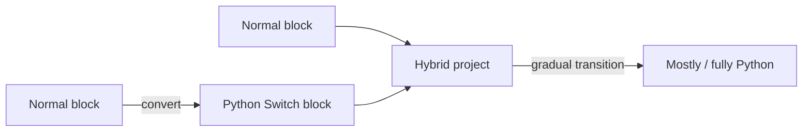

# VEXcode Switch

> 조사 기준일: 2026-11-08  
> 판정: **양방향 변환보다 '점진적 블록→텍스트 전환' 문제를 더 영리하게 푼 hybrid model**  
> 신뢰도: **B**

## 1. 핵심 아이디어

VEXcode의 Switch block은 기존 block workspace 안에 **Python text command를 직접 입력할 수 있는 text box**를 넣습니다.

학생은:
- 모든 block을 유지할 수도 있고
- 한 block만 Switch로 바꿀 수도 있고
- 점점 더 많은 부분을 Python text로 바꿀 수도 있습니다.

## 2. 변환 UX

공식 문서는:
- block을 우클릭하여 Switch block으로 변환
- Switch block에 Python command 입력
- loop 등 외부 block structure는 계속 visual하게 유지

하는 흐름을 설명합니다.



## 3. 왜 full round-trip보다 교육적으로 좋을 수 있나

Blocks → Text 전환의 어려움은 단순 syntax 암기가 아닙니다.

학생은 동시에:
- sequence
- nesting
- scope
- indentation
- punctuation
- API name
- parameter order

를 다시 해석해야 합니다.

Switch는 이 중 **program structure의 visual scaffold를 남겨둔 채 syntax만 부분적으로 텍스트화**합니다.

예:
- loop 외곽은 block
- loop body의 drive command만 Python
- 다음에는 loop 자체도 text

처럼 단계화할 수 있습니다.

## 4. 2025 연구와 연결

Lin, Weintrop, McKenna의 2025 연구는 Switch mode를 별도 transition strategy로 분석했습니다.

학생은 같은 hybrid environment에서도 여러 전략을 사용해 block/text를 조합할 수 있었습니다.

이 관점은 "무조건 양방향 변환을 구현해야 교육적으로 최고"라는 전제를 깨줍니다.

## 5. 제품 범위

현재 공식 문서에서 Switch는:
- VEXcode V5
- EXP
- IQ
- GO
- VR 일부 흐름

등으로 확장되어 있습니다.

제품별 접근 조건이 다를 수 있으며 VEXcode VR Switch는 Premium license가 필요한 경로가 있습니다.

## 6. Python 중심

공식 문서상 Switch block은 **Python과 호환**됩니다.

C++ code viewer와는 별개의 transition path입니다.

## 7. 장점

### cognitive load를 나눔
전체 representation switch가 아니라 "한 block씩" 바꿀 수 있음.

### visual nesting 보존
loop/condition 구조를 눈으로 계속 볼 수 있음.

### syntax experimentation
학생이 실제 Python command의 parameter를 직접 바꿔 볼 수 있음.

### decompiler 없이도 강한 transition UX
완전한 arbitrary Python→blocks parser 개발 비용을 피하면서 핵심 교육 목표를 달성합니다.

## 8. 기술적 관점에서 예상되는 구조

소스는 공개되지 않아 내부 구현을 단정할 수 없지만 UX상 최소한:

```
Block node
  ├─ normal block payload
  └─ switch/raw Python payload
```

같은 heterogeneous AST가 필요합니다.

Compiler는 각 node에서:
- normal block → Python emission
- switch block → user text emission

을 결합할 수 있습니다.

## 9. 우리가 가져갈 수 있는 더 발전된 버전

### Text Island block
일반 block workspace에:

```
┌ Python ───────────────┐
│ motor.run(speed=50)   │
└───────────────────────┘
```

같은 raw text island를 허용.

### 점진적 "텍스트화"
- block 하나
- stack 하나
- function 하나
- whole project

단위로 바꿀 수 있게 함.

### 언제든 지원 문법이면 되돌리기
VEX보다 한 단계 더 나아가:
- text island parse 성공 → native block으로 복원
- 실패 → text island 유지

가 가능하면 hybrid와 bidirectional의 장점을 합칠 수 있습니다.

## 10. 한계

- 일반 Python→native blocks 역변환은 아님
- hybrid AST와 code diagnostics를 잘 설계해야 함
- text island 내부 error를 visual block error와 통합해야 함
- 학생이 text island를 과도하게 사용하면 block scaffold가 의미 없어질 수 있음

## Sources

- VEXcode coding progression  
  https://kb.vex.com/hc/en-us/articles/8780205244308-Get-Started-Coding
- VEXcode V5 Switch  
  https://kb.vex.com/hc/en-us/articles/29201524290452-Using-Switch-Blocks-to-Transition-from-Blocks-to-Text-Based-Coding-in-VEXcode-V5
- VEXcode GO Switch  
  https://kb.vex.com/hc/en-us/articles/40583603167380-Using-Switch-Blocks-to-Transition-from-Blocks-to-Text-Based-Coding-in-VEXcode-GO
- VEXcode VR Switch  
  https://kb.vex.com/hc/en-us/articles/8659440073748-Accessing-VEXcode-VR-Switch
- Lin, Weintrop & McKenna (2025)  
  https://doi.org/10.1016/j.ijcci.2025.100737
